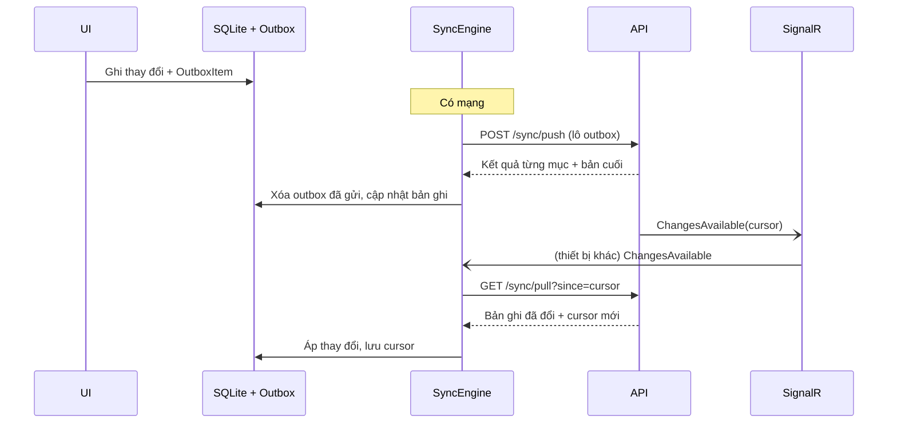

# Lưu cục bộ và đồng bộ offline

[← architecture](README.md) · [Mục lục tài liệu](../README.md)

Desktop và mobile luôn đọc, ghi vào SQLite trên máy trước, rồi đồng bộ với server qua hai endpoint `/sync/push` và `/sync/pull`. Nhờ vậy app dùng được khi mất mạng và không bao giờ chờ server mới hiện thay đổi.

## Mục lục

- [Nguyên tắc](#nguyen-tac)
- [Luồng đồng bộ](#luong)
- [Outbox](#outbox)
- [Phạm vi đồng bộ](#pham-vi)
- [Cursor và kéo thay đổi](#cursor)
- [Xử lý xung đột](#xung-dot)
- [Xóa mềm](#xoa-mem)
- [Thông báo khi offline](#thong-bao)
- [Code liên quan](#code)

## Nguyên tắc

1. **Ghi cục bộ trước.** Mọi thay đổi vào SQLite và outbox trong cùng một transaction.
2. **Id sinh ở client** bằng GUID v7, không chờ server cấp Id.
3. **Server là nguồn sự thật cuối cùng.** Sau khi push, client luôn pull để lấy bản đã gộp.
4. **SignalR chỉ báo hiệu**, không chở dữ liệu.

## Luồng đồng bộ

Chi tiết request/response: [api/sync-protocol.md](../api/sync-protocol.md).

## Outbox

| Cột | Ý nghĩa |
| --- | --- |
| `Id` | Khóa tăng dần, giữ đúng thứ tự gửi |
| `EntityType`, `EntityId` | Bản ghi bị thay đổi |
| `Operation` | `Create`, `Update`, `Delete` |
| `Payload` | JSON các trường đã đổi (chỉ trường đổi, không gửi cả bản ghi) |
| `BaseVersion` | `Version` client đang giữ lúc sửa |
| `Attempts`, `LastError` | Số lần thử, lỗi gần nhất |

Gửi theo lô tối đa 100 mục; lỗi mạng thì thử lại với backoff 1s, 2s, 4s… tối đa 60s.

## Phạm vi đồng bộ

Client chỉ giữ cục bộ những gì người dùng cần khi mất mạng:

| Có trong SQLite | Không đồng bộ, chỉ xem khi online |
| --- | --- |
| Lịch người dùng sở hữu | Lịch chia sẻ quyền `FreeBusy` |
| Lịch được chia sẻ quyền `Read`, `Write`, `Manage` (trực tiếp hoặc qua phòng ban) | Lịch của người khác không chia sẻ cho mình |
| Sự kiện người dùng được mời (qua `EventAttendees`), dù nằm ở lịch người tổ chức | Lịch phòng ban mình không thuộc |
| Task giao cho mình, lời nhắc của mình | |

Người được mời không có bản sao sự kiện: sự kiện chỉ nằm ở lịch người tổ chức, hiện trên lịch người được mời qua `EventAttendees`. Người được mời chỉ sửa được phản hồi và lời nhắc của chính mình.

**Mất quyền.** Khi chia sẻ bị thu hồi, người dùng bị rời phòng ban hoặc bị gỡ khỏi danh sách mời, pull trả mục `revoked` (`calendarId` hoặc `eventId`); client xóa bản cục bộ tương ứng, không cần tải lại toàn bộ.

**Được thêm quyền.** Dòng `CalendarShares` hoặc `EventAttendees` mới có `Version` mới. Khi dòng cấp quyền có `Version` lớn hơn cursor, pull trả kèm toàn bộ dữ liệu mà dòng đó mở ra (sự kiện cũ của lịch vừa được chia sẻ, hoặc sự kiện vừa được mời), dù bản thân các sự kiện đó có `Version` nhỏ hơn cursor.

## Cursor và kéo thay đổi

- Mỗi bảng đồng bộ có `Version` (rowversion), `UpdatedAt`, `IsDeleted`. `rowversion` tăng chung cho cả CSDL nên một cursor dùng được cho mọi bảng.
- Cursor là `rowversion` lớn nhất client đã nhận; `GET /sync/pull?since=` trả mọi bản ghi trong phạm vi có `Version` lớn hơn, kể cả bản đã xóa mềm, phân trang 500 bản ghi.
- **Chặn trên bằng `MIN_ACTIVE_ROWVERSION()`.** Transaction đang chạy có thể đã lấy `rowversion` nhỏ nhưng commit sau một transaction lấy số lớn hơn. Nếu cursor nhảy qua số lớn đó, bản ghi của transaction chậm bị bỏ sót vĩnh viễn. Vì vậy pull chỉ trả bản ghi có `Version < MIN_ACTIVE_ROWVERSION()` và cursor mới không bao giờ vượt giá trị này.
- Client chưa có cursor hoặc cursor cũ hơn 30 ngày → tải lại toàn bộ.

## Xử lý xung đột

Khi `BaseVersion` client gửi lên khác `Version` hiện tại trên server, server gộp **theo từng trường**:

| Tình huống | Kết quả |
| --- | --- |
| Trường chỉ một bên sửa | Giữ giá trị của bên đã sửa |
| Cùng sửa một trường | Bản đến server sau thắng |
| Một bên xóa, bên kia sửa | Xóa thắng, client sửa nhận thông báo "Sự kiện đã bị xóa" |
| Sửa sự kiện lặp theo phạm vi khác nhau | Áp lần lượt theo thứ tự đến server |

Server trả bản cuối để client ghi đè cục bộ. Logic nằm trong [`ConflictResolver`](../../src/Server/WorkCal.Application/Features/Sync/ConflictResolver.cs).

## Xóa mềm

Xóa luôn là đặt `IsDeleted=true`, `DeletedAt=now` để thiết bị khác biết mà xóa theo. Job [`PurgeSoftDeletedJob`](../../src/Server/WorkCal.Infrastructure/Jobs/PurgeSoftDeletedJob.cs) xóa hẳn sau 30 ngày.

## Thông báo khi offline

Client đặt thông báo cục bộ cho 7 ngày tới sau mỗi lần đồng bộ, **tối đa 64 thông báo gần nhất** (giới hạn thông báo chờ của iOS; Android dùng cùng giới hạn cho nhất quán). Lịch thông báo được tính lại mỗi khi mở app, đồng bộ xong hoặc tác vụ nền chạy, nên cửa sổ 64 thông báo luôn trượt theo thời gian. ID thông báo cố định theo `(EventId, thời điểm nhắc)` nên push từ server và thông báo cục bộ không báo trùng.

## Code liên quan

| Phần | File |
| --- | --- |
| SQLite cục bộ | [`Client.Core/Local/`](../../src/Clients/WorkCal.Client.Core/Local/) |
| Outbox | [`Client.Core/Local/Outbox/`](../../src/Clients/WorkCal.Client.Core/Local/Outbox/) |
| SyncEngine | [`Client.Core/Sync/SyncEngine.cs`](../../src/Clients/WorkCal.Client.Core/Sync/SyncEngine.cs) |
| Push, pull | [`Application/Features/Sync/`](../../src/Server/WorkCal.Application/Features/Sync/) |
| Test | [`Client.Core.Tests/Sync/`](../../tests/WorkCal.Client.Core.Tests/Sync/) · [`Api.IntegrationTests/Sync/`](../../tests/WorkCal.Api.IntegrationTests/Sync/) |

Task: [giai đoạn 2](../roadmap/phase-2-offline-mobile.md).

[↑ Về đầu trang](#top)
