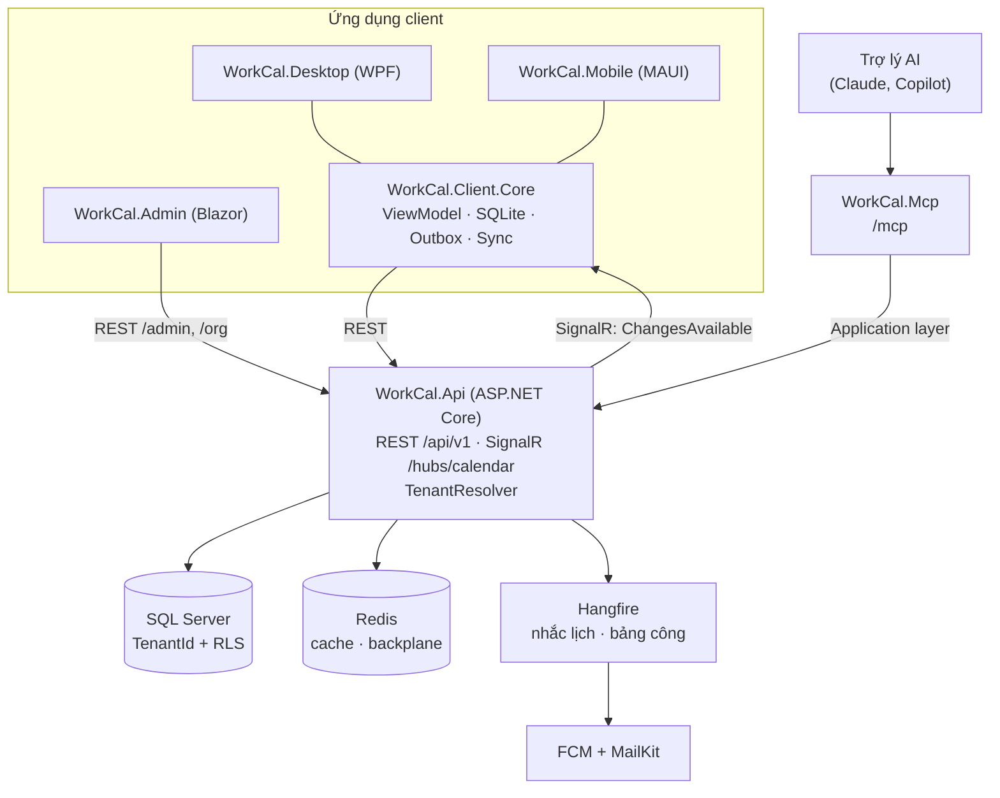

# Tổng quan kiến trúc

[← architecture](README.md) · [Mục lục tài liệu](../README.md)

Ba ứng dụng client (desktop, mobile, web quản trị) và MCP server đều đi qua một API duy nhất; không client nào truy cập CSDL server trực tiếp. SignalR chỉ báo "có thay đổi" để client tự kéo dữ liệu về.

## Mục lục

- [Sơ đồ tổng thể](#so-do)
- [Các thành phần](#thanh-phan)
- [Các tầng backend](#cac-tang)
- [Tech stack](#tech-stack)
- [Luồng một request](#luong-request)

## Sơ đồ tổng thể

File gốc: [diagrams/architecture.mmd](diagrams/architecture.mmd).

## Các thành phần

| Thành phần | Vai trò | Code |
| --- | --- | --- |
| WorkCal.Desktop | App WPF cho Windows, kéo thả lịch, toast | [`src/Clients/WorkCal.Desktop/`](../../src/Clients/WorkCal.Desktop/) |
| WorkCal.Mobile | App MAUI cho Android/iOS, push, chấm công | [`src/Clients/WorkCal.Mobile/`](../../src/Clients/WorkCal.Mobile/) |
| WorkCal.Client.Core | ViewModel, API client, SQLite, sync dùng chung cho desktop và mobile | [`src/Clients/WorkCal.Client.Core/`](../../src/Clients/WorkCal.Client.Core/) |
| WorkCal.Admin | Web quản trị Blazor: `/platform` và `/org` | [`src/Clients/WorkCal.Admin/`](../../src/Clients/WorkCal.Admin/) |
| WorkCal.Api | REST, SignalR, xác thực, middleware tenant | [`src/Server/WorkCal.Api/`](../../src/Server/WorkCal.Api/) |
| WorkCal.Mcp | MCP server cho trợ lý AI (v1.1) | [`src/Server/WorkCal.Mcp/`](../../src/Server/WorkCal.Mcp/) |
| WorkCal.Contracts | DTO dùng chung server và client | [`src/Shared/WorkCal.Contracts/`](../../src/Shared/WorkCal.Contracts/) |

## Các tầng backend

Clean Architecture, phụ thuộc chỉ đi vào trong: **Api → Infrastructure → Application → Domain**.

| Tầng | Chứa gì | Không được chứa |
| --- | --- | --- |
| [Domain](../../src/Server/WorkCal.Domain/) | Entity, value object, quy tắc nghiệp vụ (trùng giờ, quyền trên lịch) | EF Core, HTTP, bất kỳ framework nào |
| [Application](../../src/Server/WorkCal.Application/) | Use case dạng command/query theo feature, validator, interface | Code truy cập CSDL cụ thể |
| [Infrastructure](../../src/Server/WorkCal.Infrastructure/) | EF Core, SQL Server, Redis, Hangfire, FCM, email, Excel/PDF | Logic nghiệp vụ |
| [Api](../../src/Server/WorkCal.Api/) | Controller, hub, middleware, DI | Logic nghiệp vụ |

Quy tắc chi tiết: [`.claude/rules/clean-architecture.md`](../../.claude/rules/clean-architecture.md).

## Tech stack

| Tầng | Công nghệ |
| --- | --- |
| Desktop | WPF + CommunityToolkit.Mvvm |
| Mobile | .NET MAUI |
| Web quản trị | Blazor Web App (Interactive Server) + MudBlazor |
| Giao diện lịch | Syncfusion Scheduler (giấy phép Community) |
| CSDL cục bộ | SQLite + EF Core |
| Backend | ASP.NET Core trên .NET 10, Clean Architecture |
| Thời gian thực | SignalR + Redis backplane |
| CSDL server | SQL Server 2022 + EF Core 10 |
| Job nền | Hangfire |
| Lịch lặp | Ical.Net + NodaTime |
| Xác thực | ASP.NET Core Identity, JWT, refresh token, OAuth/OIDC |
| Thông báo | Firebase Cloud Messaging, MailKit, toast Windows |
| Báo cáo | ClosedXML, QuestPDF |
| Log | Serilog, OpenTelemetry, Seq |
| Test | xUnit, FluentAssertions, Testcontainers, bUnit, Playwright |
| Triển khai | Docker Compose, GitHub Actions |

Lý do chọn: xem [adr/](adr/README.md).

## Luồng một request

1. Client gửi request kèm JWT (claim `sub`, `tid`, `role`).
2. Middleware `TenantResolver` kiểm tra membership và tenant chưa bị khóa, gán `ITenantContext`.
3. Controller chuyển thành command/query; pipeline chạy validator, log, transaction, audit.
4. Handler dùng `AppDbContext`; query filter và Row-Level Security giới hạn theo tenant.
5. Ghi thành công thì phát `ChangesAvailable` qua SignalR, đặt job Hangfire nếu có lời nhắc.
6. Lỗi trả về theo ProblemDetails ([conventions.md](../api/conventions.md)).

[↑ Về đầu trang](#top)
