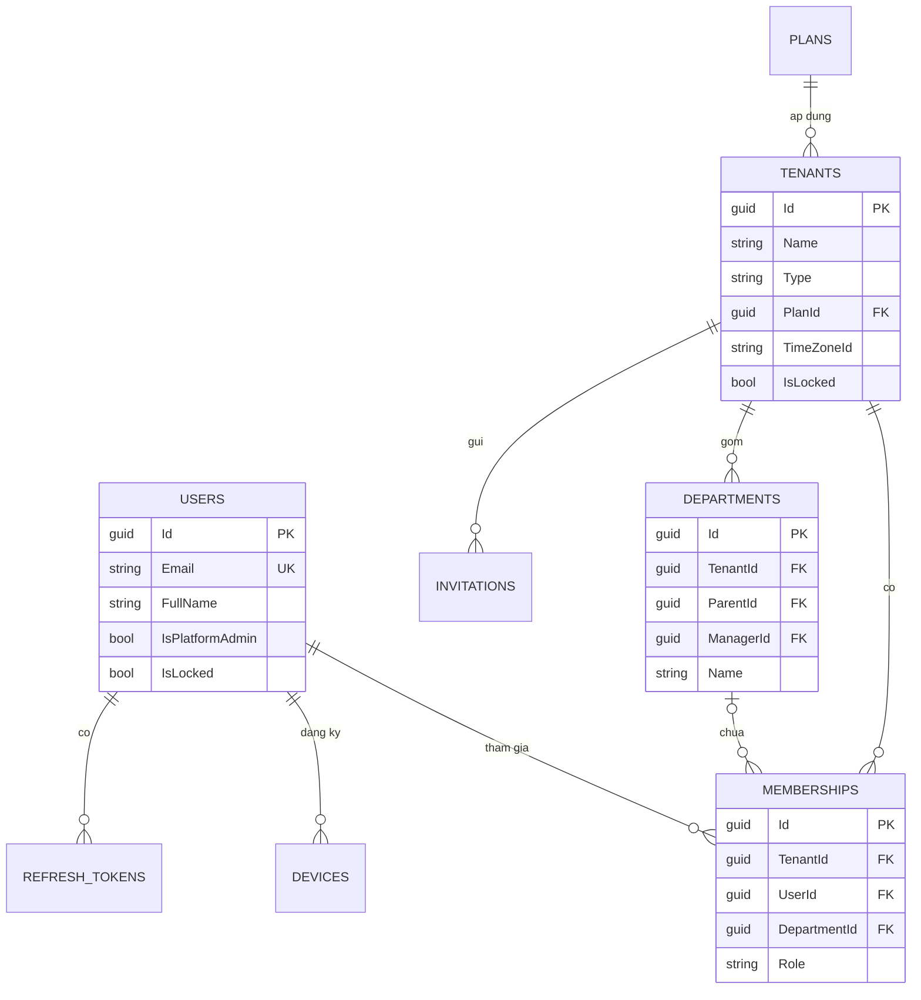
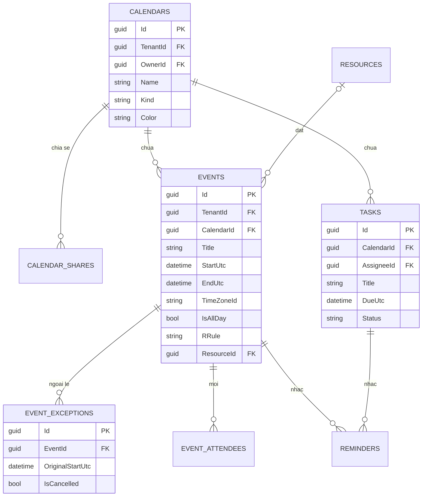
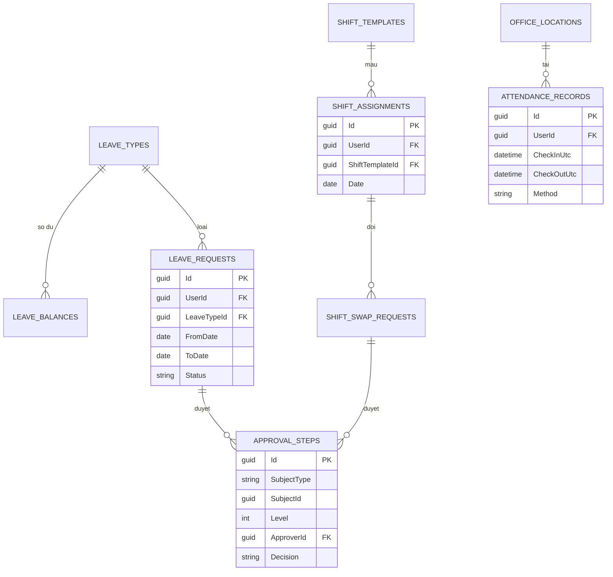
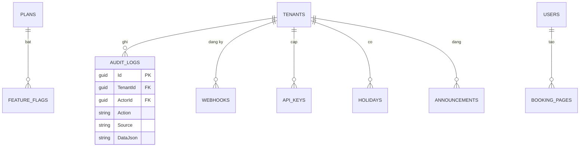

# Sơ đồ quan hệ (ERD)

[← database](README.md) · [Mục lục tài liệu](../README.md)

Sơ đồ chia theo nhóm để dễ đọc. Mọi bảng nghiệp vụ có `TenantId`; các bảng đồng bộ có thêm `Version`, `UpdatedAt`, `IsDeleted` (không vẽ lại ở mỗi bảng).

## Mục lục

- [Nhóm 1 · Tài khoản và tenant](#nhom-1)
- [Nhóm 2 · Lịch, sự kiện, task](#nhom-2)
- [Nhóm 3 · Nghỉ phép, ca, chấm công](#nhom-3)
- [Nhóm 4 · Nền tảng và tích hợp](#nhom-4)

## Nhóm 1 · Tài khoản và tenant

## Nhóm 2 · Lịch, sự kiện, task

## Nhóm 3 · Nghỉ phép, ca, chấm công

## Nhóm 4 · Nền tảng và tích hợp

File gốc nhóm 2: [architecture/diagrams/erd.mmd](../architecture/diagrams/erd.mmd). Chi tiết cột: [data-dictionary.md](data-dictionary.md).

[↑ Về đầu trang](#top)
